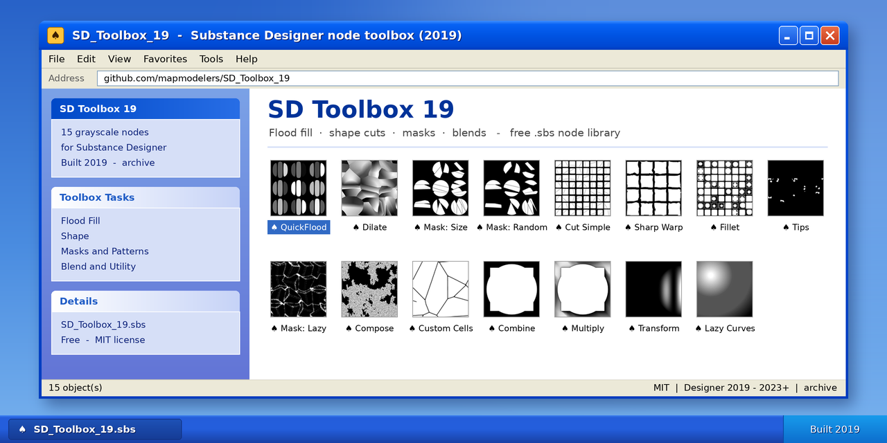

# SD Toolbox 19

[-ece9d8)](CHANGELOG.md)

A free **Substance 3D Designer node library** (`.sbs`) of 15 grayscale utility nodes for procedural texturing: **flood fill** shortcuts, **shape cutting**, **mask generators** (curvature, slope, edge wear, dirt, leaks), and **blend** and transform helpers. Built in **2019**, published in 2026 as an **archive**: cleaned up and documented, not maintained.

It uses only the stock library, with no bitmaps. Every node has a library icon, a description and documented parameters.

| File | For |
|---|---|
| [`SD_Toolbox_19.sbs`](https://github.com/mapmodelers/SD_Toolbox_19/releases/download/archive-2026/SD_Toolbox_19.sbs) | Substance 3D Designer 2023 and later |
| [`SD_Toolbox_19_SD2019.sbs`](https://github.com/mapmodelers/SD_Toolbox_19/releases/download/archive-2026/SD_Toolbox_19_SD2019.sbs) | Substance Designer 2019 to 2022 (original 2019 format) |

## Install

1. Download the file for your Designer version (links above, or from the [release](https://github.com/mapmodelers/SD_Toolbox_19/releases/tag/archive-2026)).
2. **Edit › Preferences › Projects › Library**: add its folder (not recursive). The tools appear under **SD_Toolbox_19**, with ♠ in front of their names.
3. Open the package to see **♠ SD Toolbox 19 Showroom**, one demo of each tool.

## Tools

| | Tool | Does |
|---|---|---|
| | **Flood Fill** | |
| 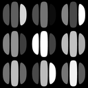 | **QuickFlood** | Flood fill in one node: Size, Gradient and 2 Random maps, gaps filled |
| 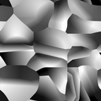 | **Dilate** | Grows each shape's value into the black gaps around it |
| 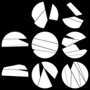 | **Mask: Size** | Keeps the largest or smallest shapes |
| 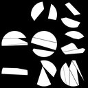 | **Mask: Random** | Keeps a random share of the shapes |
| | **Shape** | |
| 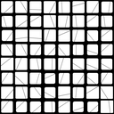 | **Cut Simple** | Cuts every shape along a random line |
| 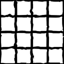 | **Sharp Warp** | Chips straight edges into sharp breaks |
| 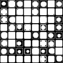 | **Fillet** | Rounds the shapes' corners |
| 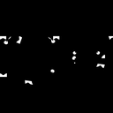 | **Tips** | Isolates the inner and/or outer tips of the shapes |
| | **Masks and Patterns** | |
| 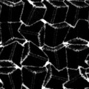 | **Mask: Lazy** | 10 masks from a height map: curvature, slopes, wear, dirt, leaks, sun bleach |
| 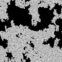 | **Compose** | Keeps a pattern only inside large enough shapes |
| 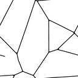 | **Custom Cells** | Turns a shape pattern into bevelled cells |
| | **Blend and Utility** | |
| 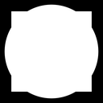 | **Combine** | Add / subtract through a mask |
| 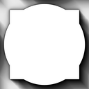 | **Multiply** | Multiply through a mask |
|  | **Transform** | Transform 2D with tile X / Y / both toggles |
| 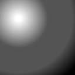 | **Lazy Curves** | 9 preset contrast curves |

Most flood-fill tools start with a **Clear Input** step (a Histogram Scan, Position / Contrast) that turns a soft mask into clean shapes. Every parameter and output has a description in Designer.

<b>Demo of each tool</b> (Showroom, rendered at 2048 px)

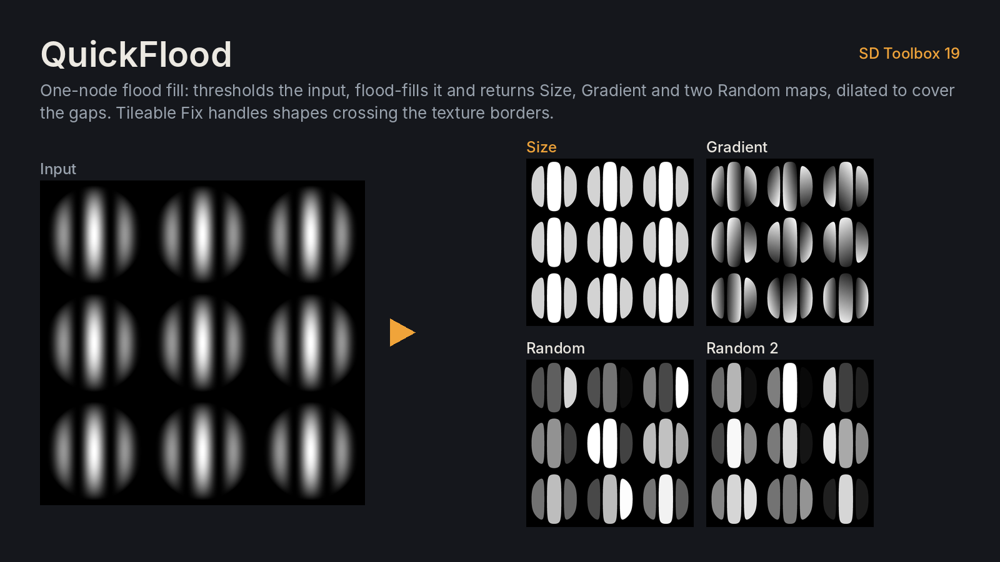
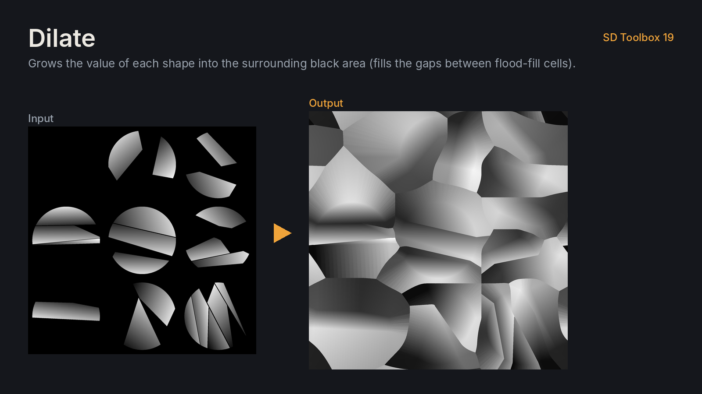
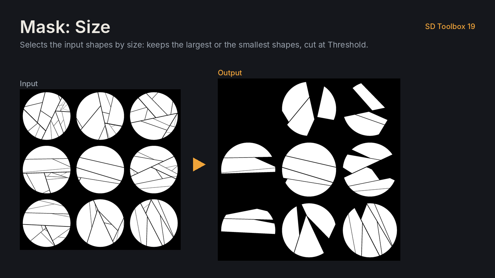
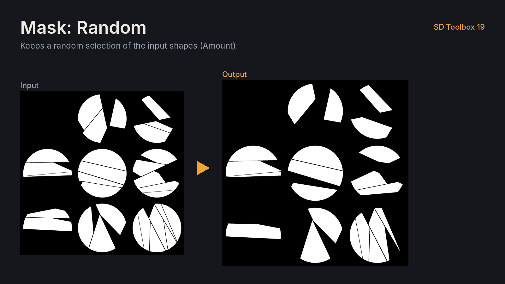
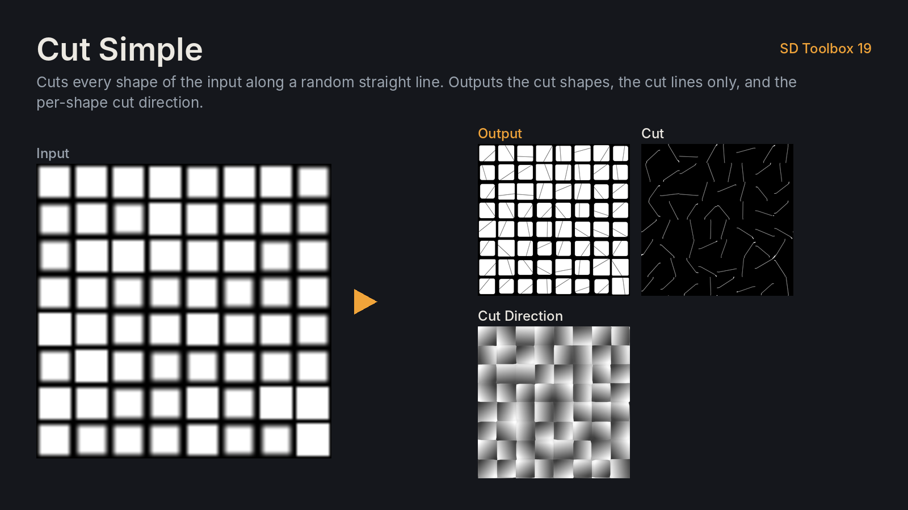
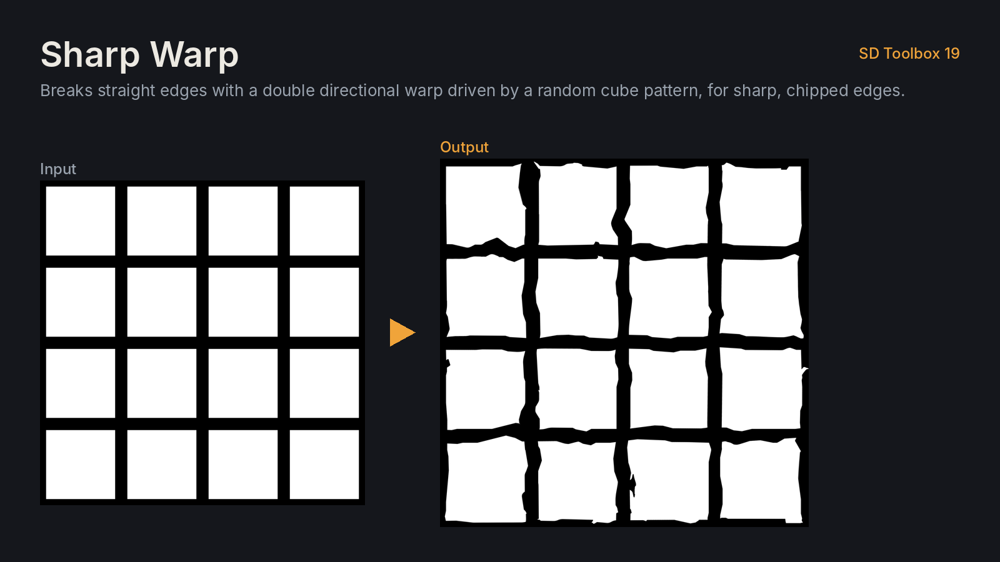
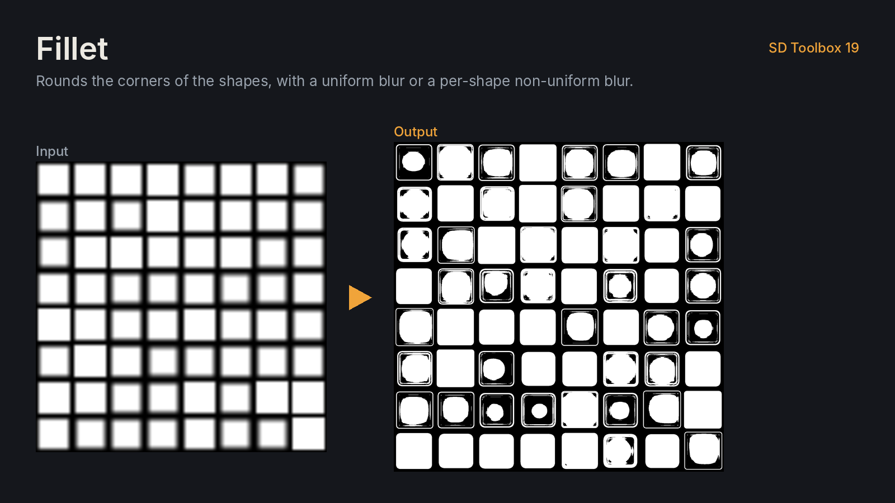
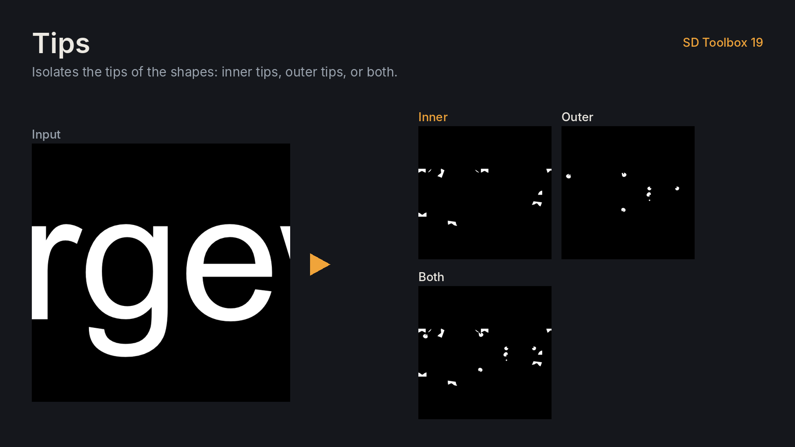
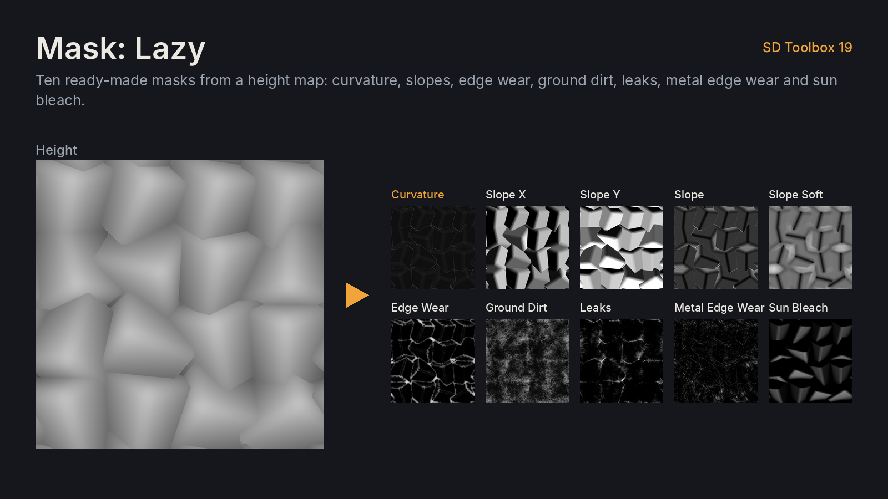
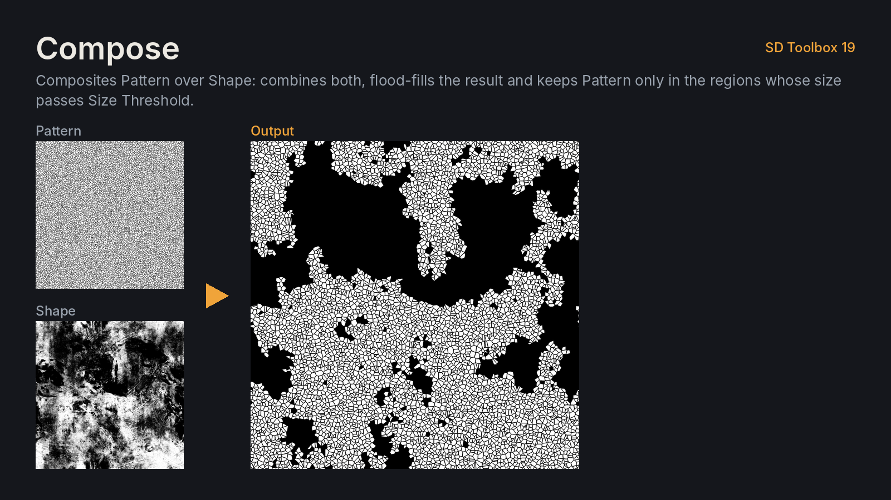
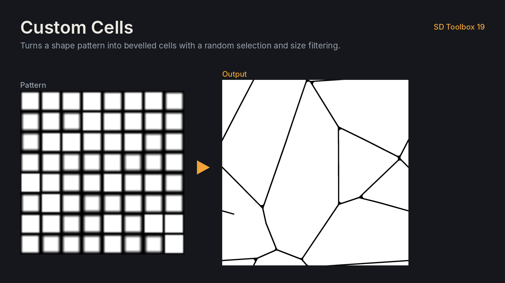
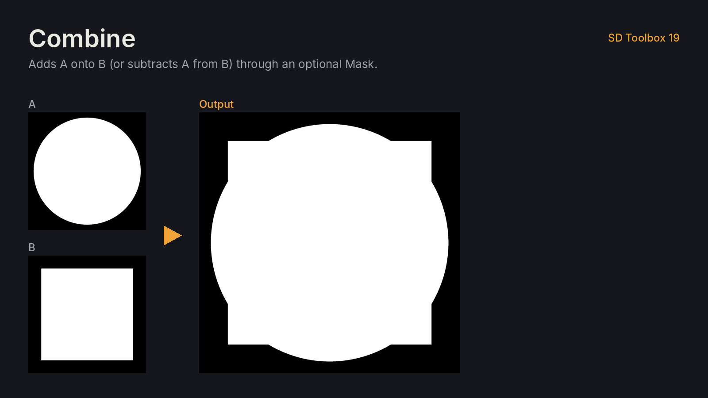
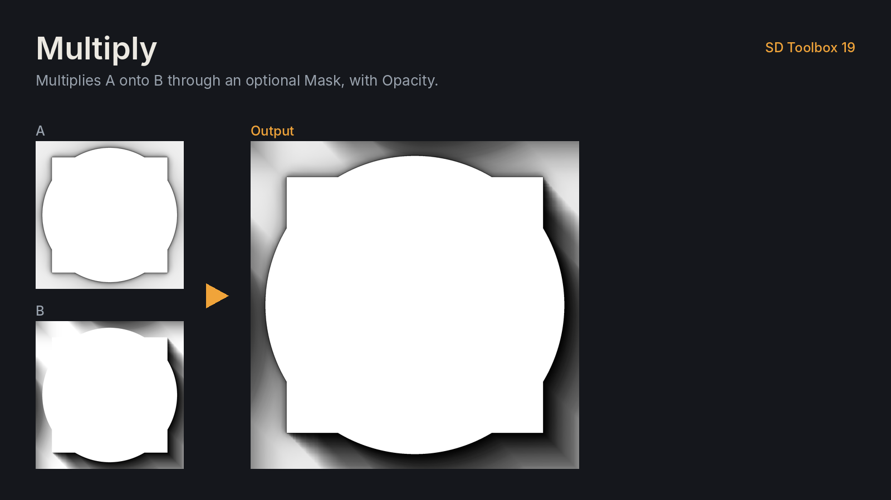
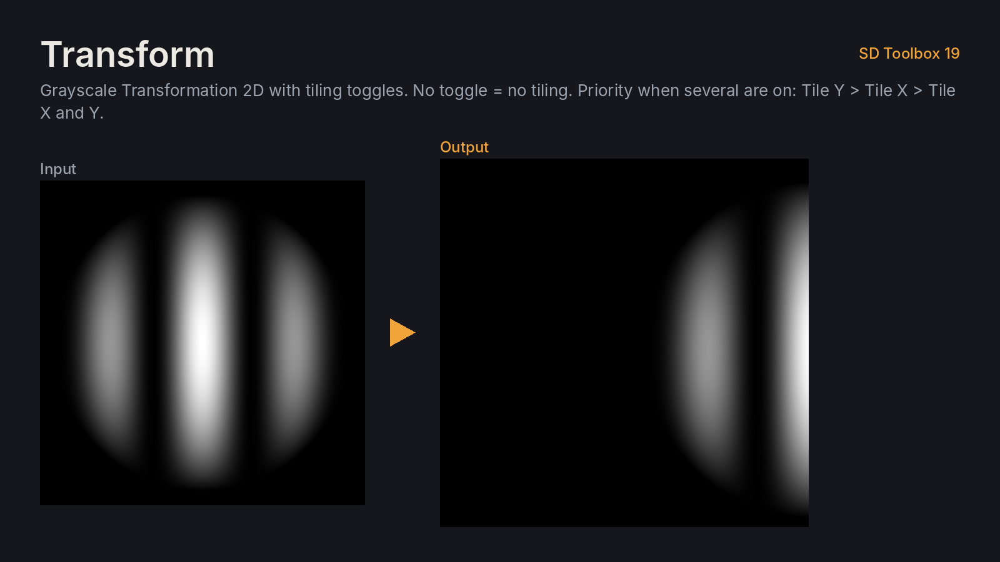
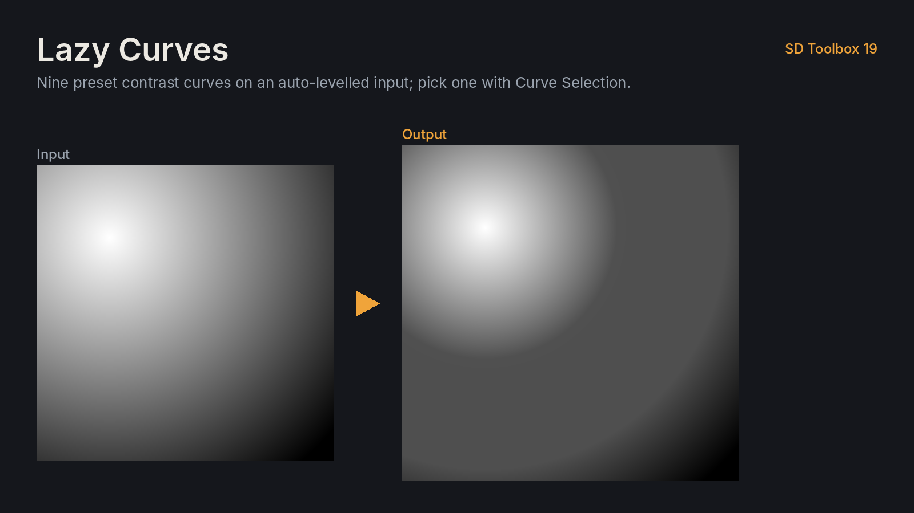

---

[Changelog](CHANGELOG.md) · MIT [License](LICENSE) · Adrien Lelièvre, [ArtStation](https://www.artstation.com/adrienlelievre) · `tools/` holds the build scripts (format update, compile check, demo renders)

Keywords: Substance Designer, Substance 3D Designer, Adobe Substance, SBS node library, procedural textures, procedural materials, flood fill, curvature mask, slope mask, edge wear, texture tools, game art, technical art.
